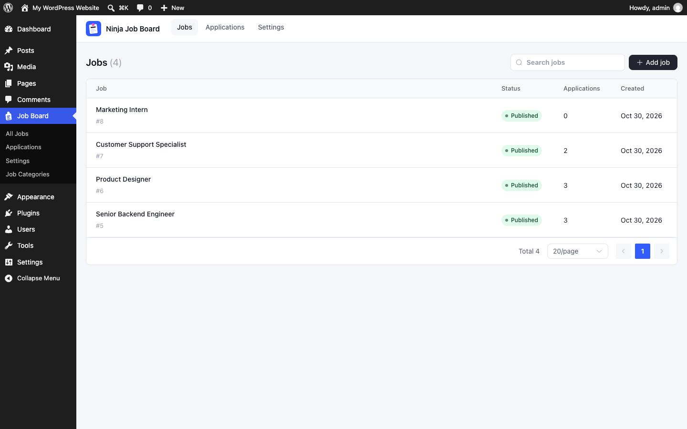
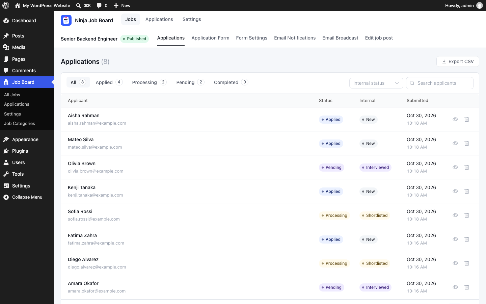
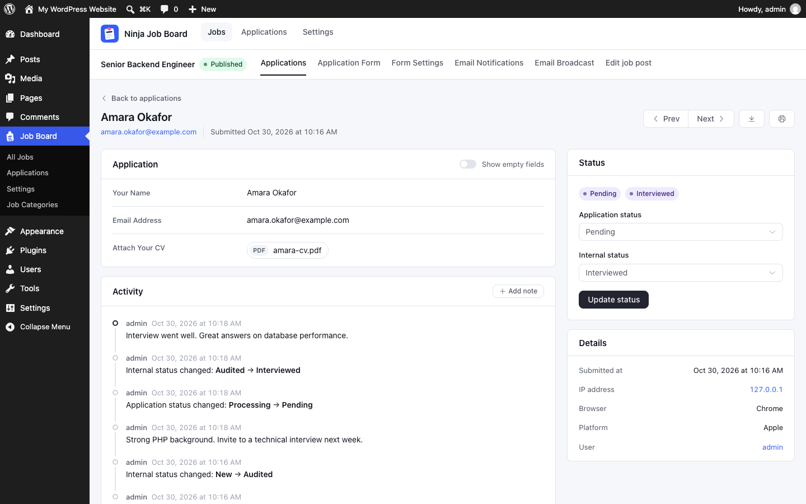
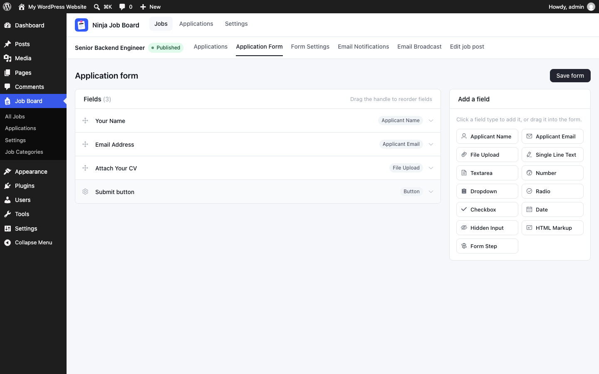
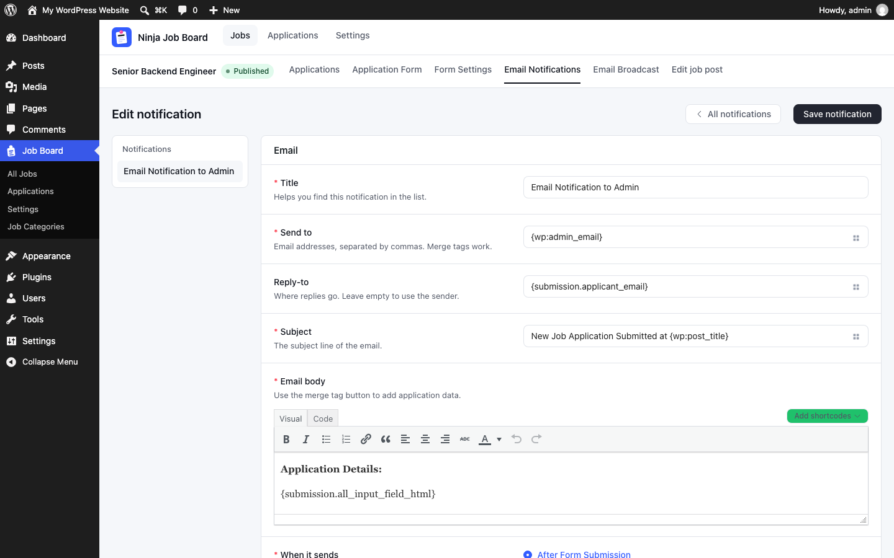
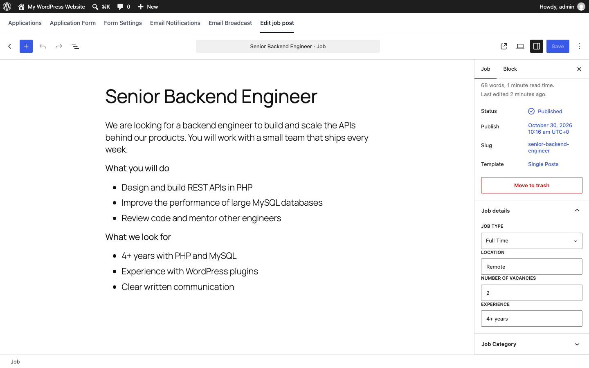
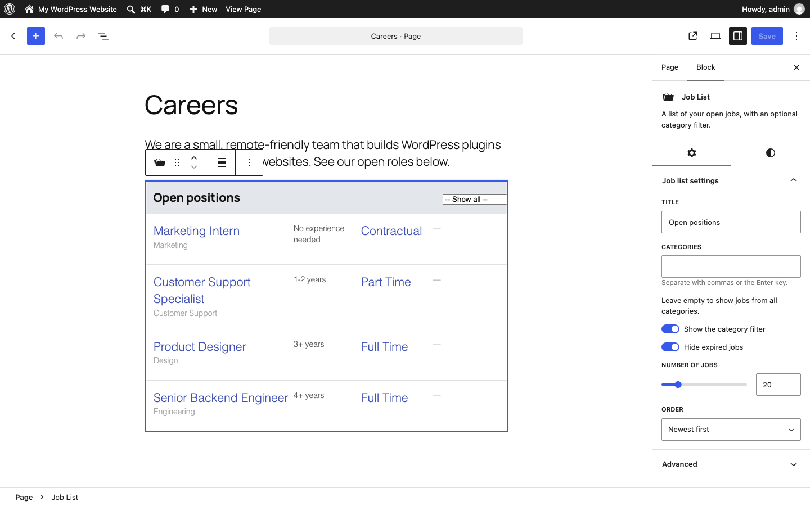
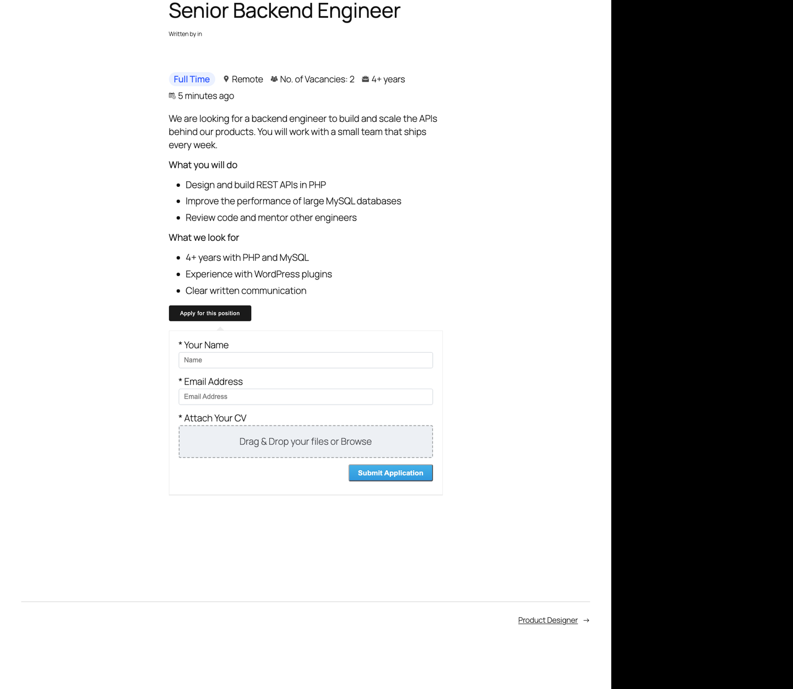
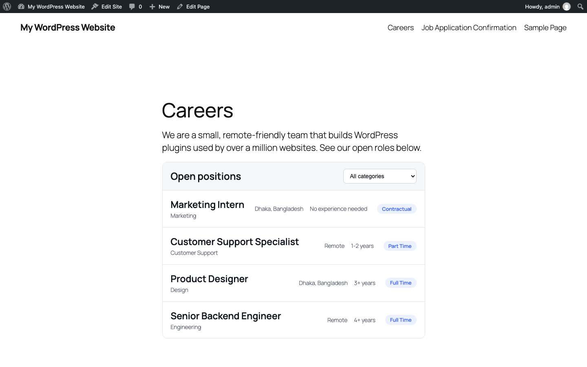
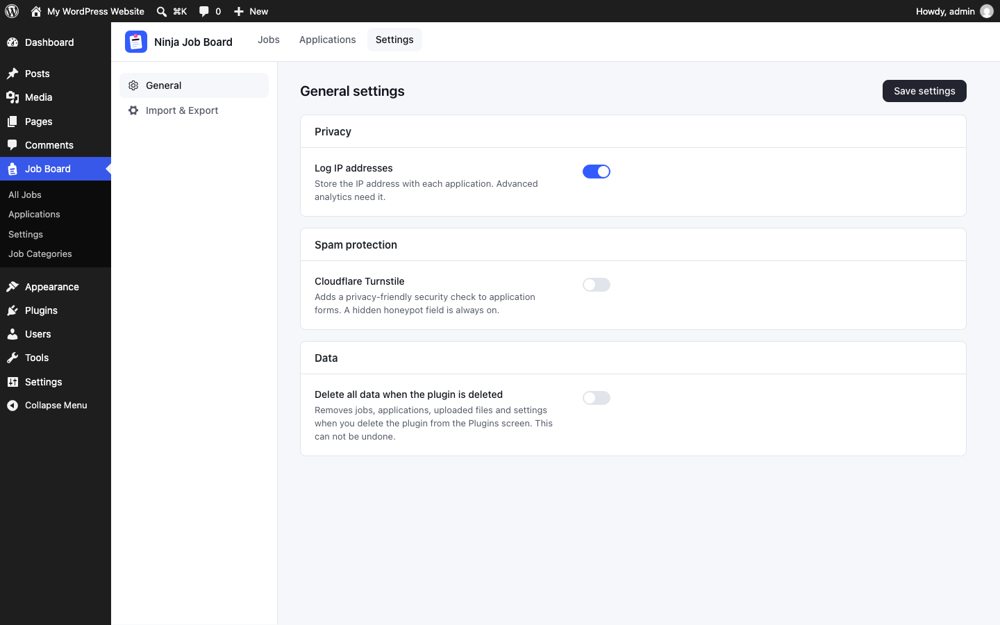

# Ninja Job Board

Post jobs, collect applications with CVs, and manage applicants in WordPress.

[Download from WordPress.org](https://wordpress.org/plugins/ninja-job-board/) · Requires WordPress 6.3+ and PHP 7.4+

## Features

- **Jobs and a careers page.** Each job is a WordPress post. List jobs with the Job List block or `[wp_job_list]`, and show a form anywhere with the Job Application Form block or `[wp_job_form id="123"]`.
- **Application form builder.** Drag and drop fields: name, email, CV upload, text, number, dropdown, radio, checkboxes, date, hidden, HTML and form steps.
- **Applicant tracking.** Status tabs, an application status and a private internal status, notes, an activity timeline, search, print and CSV export.
- **Email.** Notifications on each application, and a broadcast to all applicants with a given status.
- **Security and privacy.** Private CV downloads, a honeypot and optional Cloudflare Turnstile, the WordPress privacy export and erase tools, optional IP logging, and an opt-in data cleanup on uninstall.

## Screenshots

| | |
|---|---|
|  All jobs |  Applications for a job |
|  An application |  Application form builder |
|  Email notifications |  A job in the block editor |
|  The Job List block |  A job page with the form |
|  The job list on your site |  General settings |

## Development

The admin app uses Vue 3, Element Plus and Vite. The blocks use the WordPress block editor packages.

```bash
npm install
npm run build   # build assets/admin, assets/blocks and assets/css
npm run dev     # rebuild on change
```

Source files:

- `src/admin/`: the admin app
- `src/blocks/`: the Gutenberg blocks and the job editor panel
- `src/scss/`: admin and front-end styles
- `includes/`: PHP. REST routes are in `includes/Http/Router.php`.

### Tests

PHP integration tests run against a real WordPress install and database. See [tests/README.md](tests/README.md) for the setup.

```bash
composer install
npm run test:php
```

### WordPress.org assets

`.wordpress-org/` holds the plugin icon, banner and screenshots for the WordPress.org page. `banner.html` is the source of the banner. These files are not part of the plugin release.

## License

GPLv2 or later.
